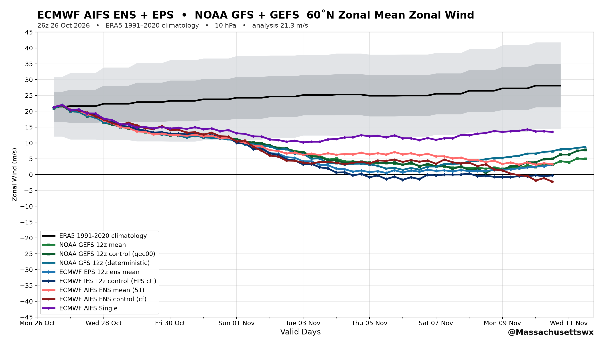
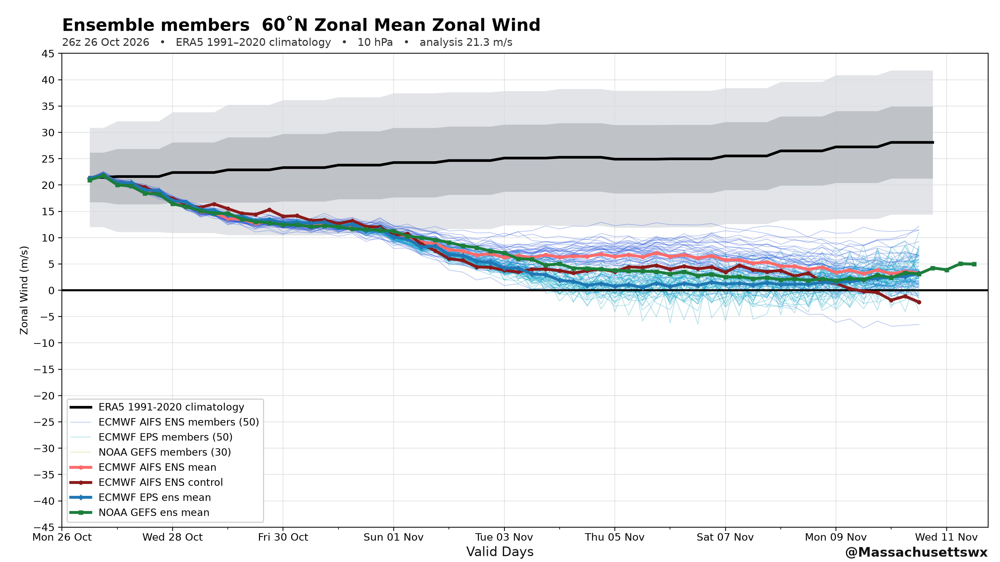

# Stratosphere forecast charts

Automated, self-updating charts of **zonal-mean zonal wind at 60˚N / 10 hPa (1 mb)**
from every major operational ensemble, against the **ERA5 1991–2020 climatology**.



*The "Hybrid" tab: physics-based and AI models on one graph.*



*The "Ensembles" tab: AIFS ENS (50), ECMWF EPS (50) and GEFS (30) members with the
bold ensemble mean and control on top.*

| tab | what's on it |
|---|---|
| **Physics-based** | ECMWF IFS + EPS, NOAA GFS + GEFS |
| **AI** | ECMWF AIFS Single + AIFS ENS (51 members) |
| **Hybrid** | every model on one graph — physics and AI together |
| **Ensembles** | member spaghetti for each ensemble, with mean + control |

**Which models appear depends on the cycle:** the **06z and 18z suites carry no
ECMWF control (IFS) and no ECMWF EPS** — ECMWF publishes those two products in
those runs only out to **144 h**, while the 00z/12z suites go to 240 h — so those
charts show AIFS + GFS/GEFS only and a 15-day chart never stops early. The 00z
and 12z suites include the ECMWF control and EPS. Chart titles, legends **and the
model table** are built from the models actually present, so they never
advertise a system that isn't plotted.

Refreshed by a **15-minute poll** plus a deadline sweep at 03, 09, 15 and 21 UTC —
nine hours after each model initialisation, i.e. three hours after the next
cycle's analysis (00Z init → 09Z, 06Z → 15Z, 12Z → 21Z, 18Z → 03Z). The cron is
UTC and never changes; after US DST ends on **1 Nov 2026** these simply read one
hour later in local terms (03Z = 10pm EST instead of 11pm EDT). Everything on the
site is labelled UTC.

---

## Quickstart

```bash
make venv          # virtualenv + deps
make sync          # fetch the newest cycle, render all four tabs
make serve         # http://localhost:8000  (JSON API included)
make site          # static build into site_out/  (for GitHub Pages)
```

or without make:

```bash
venv/bin/python scripts/pipeline.py sync --level 10 --lat 60
venv/bin/python -m uvicorn webapp.app:app --port 8000
venv/bin/python scripts/build_site.py --out site_out
```

`make sync-quick` skips the ensemble-member series (means and controls only) —
roughly 4× faster when you just want the headline chart.

## Deploying

See **[DEPLOY.md](DEPLOY.md)**. GitHub Pages is free for a public repo: push this
repo, set *Pages → Source: GitHub Actions*, allow the workflow to write to the
repo, and the scheduled job publishes the site on its own. A ~$4/mo VPS with
systemd + nginx is the alternative if you would rather serve the FastAPI app.

## How the automation works

**Fluid publishing.** A light poll runs every 15 minutes. Each pass resolves the
newest published cycle, fetches only the series that are missing, and compares
the set of models it now has against the set it last published. The page is
rebuilt the moment that set changes — so a late ensemble member triggers a
re-publish instead of waiting for the next scheduled run. A cycle is only
published once **every** model (AIFS ENS, AIFS Single, ECMWF EPS + IFS control,
GFS, GEFS mean + control) has landed; if something is still missing at the
9-hour deadline the page goes up anyway, flagged `PARTIAL`. The 03/09/15/21 UTC
schedule remains as the deadline sweep and backstop.

```
every 15 min  (+ 03/09/15/21 UTC deadline sweep)
   └─ resolve the newest published cycle   (ECMWF + NCEP, by direct probing)
   └─ fetch only the series that are missing
        └─ raw GRIB2 -> HTTP Range request for the u@10 hPa message only
           (the published .index files give the byte offsets)
   └─ reduce to zonal-mean u at 60˚N, plus the NH area-weighted mean
   └─ render the four tabs from the ERA5 cache (instant, all 37 levels)
   └─ update data/store/  ->  static site  ->  deploy
```

The ERA5 climatology is cached locally (`data/era5_cache/`, 1991–2020, daily
12Z, **all 37 pressure levels**), so the climatology side of any figure is an
instant lookup and never touches the network again. The repo carries a slim
copy of it (`data/era5_cache_slim/`, levels 1/3/10/30/50/100/250) for the
GitHub Actions runner — `era5_cache.py` maps the level through
`level_index.npy`, so the runner asks for the same level as the build machine
(10 hPa, not 100 hPa).

## Data sources

| series | source |
|---|---|
| ECMWF AIFS ENS (51 members), AIFS Single, IFS control, EPS (50 perturbed) | ECMWF open data, 0.25° |
| NOAA GFS (deterministic) | NOAA open data, 0.25° |
| NOAA GEFS (mean, control, 30 perturbed) | NOAA open data, 0.5° |
| ERA5 1991–2020 climatology | ARCO-ERA5 (Google Cloud), 0.25° |

GFS/GEFS are redistributed under the NOAA Open Data Dissemination program;
ECMWF data under the ECMWF open-data licence. Attribution is requested by
NOAA — see [LICENSE](LICENSE).

## Repo layout

```
scripts/
  pipeline.py        run store + sync + render  (the entry point)
  render.py          the four tabs, house style
  build_site.py      static build for GitHub Pages
  era5_cache.py      ERA5 climatology cache (build / query / extend, slim-aware)
  site_meta.py       shared model metadata for the two front ends
  fetch_aifs.py      ECMWF AIFS ENS   (raw GRIB2, range-fetched)
  fetch_aifs_single.py  ECMWF AIFS Single
  fetch_eps.py       ECMWF EPS members + IFS control
  fetch_noaa.py      NOAA GFS / GEFS (mean, control, members)
  export_era5_slim.py   slim climatology for the repo
webapp/              FastAPI app (same template as the static site)
data/store/          figures, series, latest.json  <- what the site serves
data/era5_cache/     full ERA5 climatology cache (local)
.github/workflows/   the 4x-daily watcher + Pages deploy
```

## House style

Bold far-left title, thin blue member spaghetti, light-red ensemble mean and
dark-red control with circle markers, heavy black ERA5 climatology with gray
±1σ/±2σ band, a bold 0 m/s reference line, valid dates every 2 days along the
bottom with `Valid Days` centred, and `@Massachusettswx` bottom right.
